# Uno with Friends

<div align="center">
  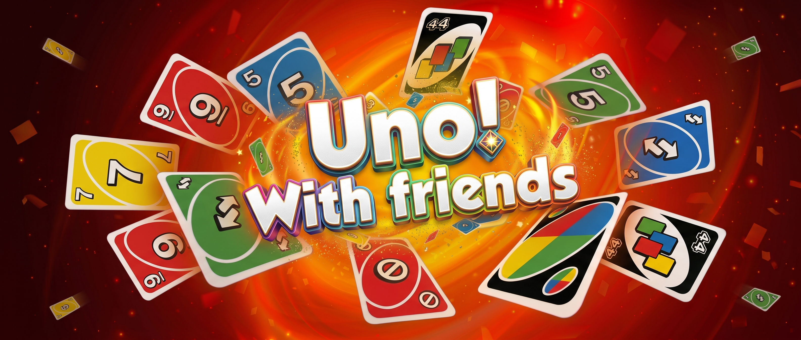
<br>

**[About](#about) ·
[Features](#features) ·
[Preview](#preview) ·
[Team Roles & Workflow](#team-roles--workflow) ·
[Tech Stack](#tech-stack) ·
[Running the Project](#running-the-project)**

</div>

## About

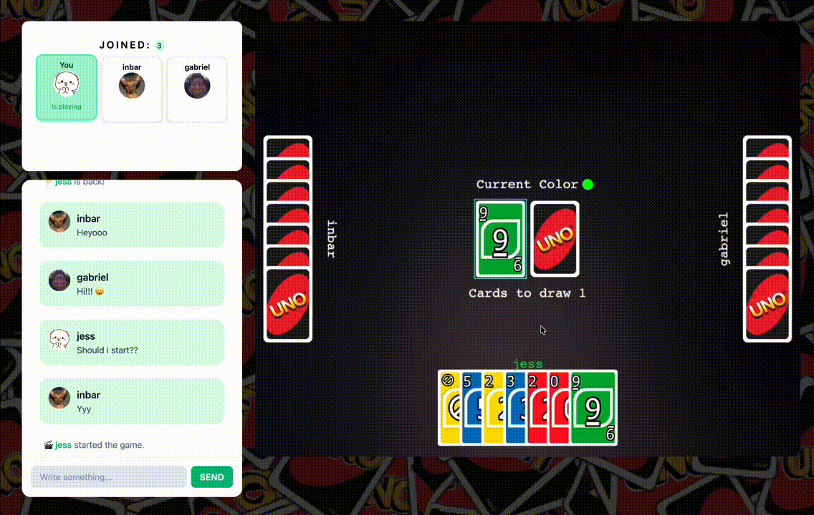<br>

A real-time online multiplayer card game, built from the ground up by a team of four developer students at [42 Berlin](https://www.42berlin.de/).

We chose to build a multiplayer game experience to challenge our skills in real-time communication, complex state synchronization and responsive design while delivering a fun and engaging user experience of a card game everyone knows and loves: "Uno!".

## Features

- **Real-Time Multiplayer:** Play Uno with friends seamlessly via WebSocket connections.
- **Matchmaking & Lobbies:** Create private rooms with custom invite links or join existing matches.
- **Live Game State:** Highly synchronized game engine that validates moves, handles turn order and calculates scoring server-side.
- **User Accounts & Profiles:** Secure authentication system with match history, win/loss tracking and customizable avatars.
- **In-Game Chat:** Communicate with lobby members while playing.
- **Responsive UI:** Clean, mobile-friendly interface designed for an optimal user experience across desktop and mobile devices.

## Preview

The interface is designed to be responsive and mobile-friendly, guiding players from account access to their first match.

#### 1. Sign in or register

Players can sign in or create an account from the landing page. After either action, they are redirected to their homepage.

<div align="center">
  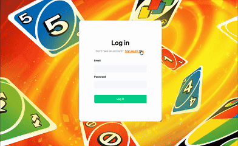<br>
</div>

#### 2. Player dashboard

The homepage brings together the player's profile information, global leaderboard, match history and game access cards.

<div align="center">
  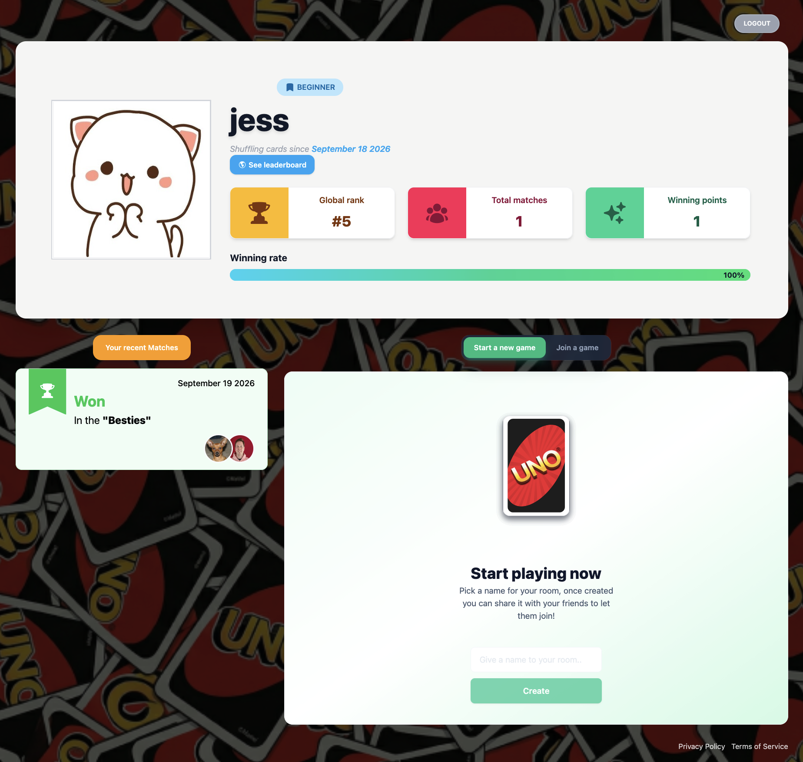<br>
</div>

#### 3. Profile and experience

The profile view displays personal statistics, match history and experience badges. New players see a personalized onboarding view that invites them to play their first match and start gaining experience.

<table align="center">
  <tr>
    <td align="center">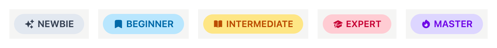</td>
  </tr>
  <tr>
    <td align="center">
      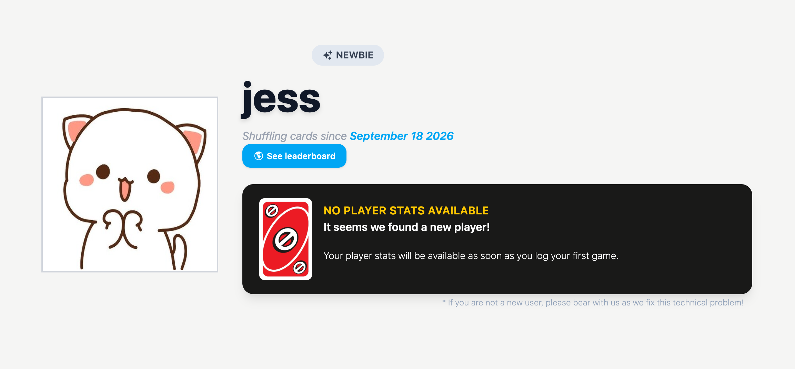
      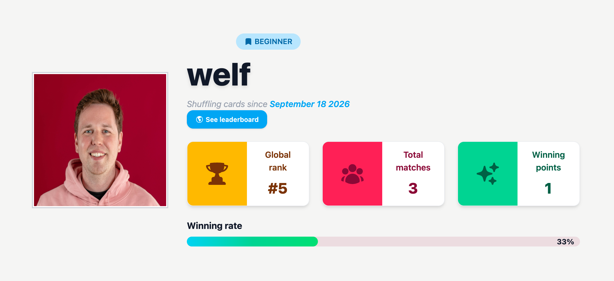
      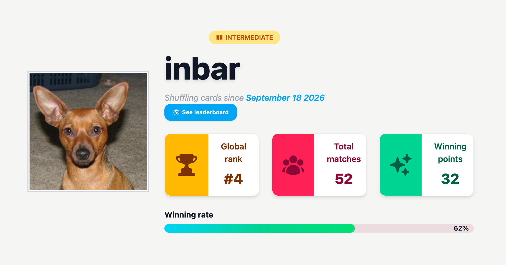
      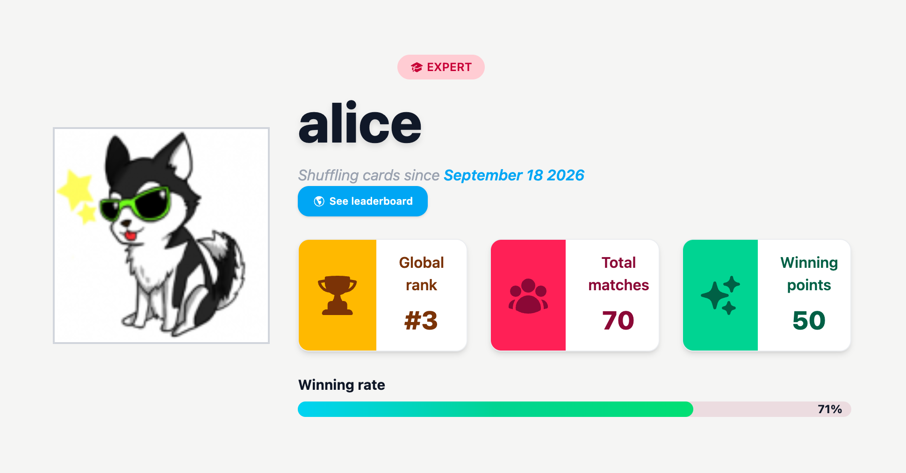
      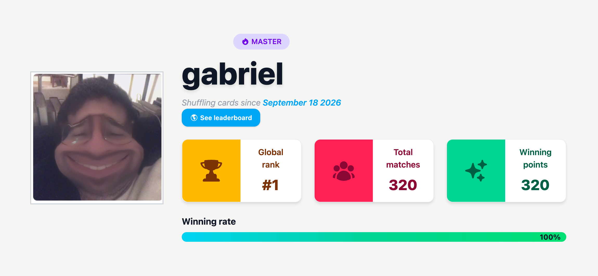
    </td>
  </tr>
</table>

#### 4. Create or join a game

Players can switch between creating a new room and joining an existing one. If a player is already in a room, an alert gives them limited time to either rejoin that room or leave before accessing a new one.

<table align="center">
  <tr>
    <td align="center" valign="middle">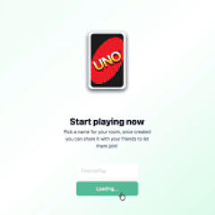</td>
    <td align="center" valign="middle">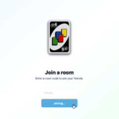</td>
    <td align="center" valign="middle">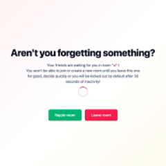</td>
  </tr>
</table>

#### 5. Room and chat

Once inside a room, players can copy the room link and share it with friends. They can also see player status updates and communicate through the in-game chat. By the end of the match, the game results are displayed and players can return to the dashboard.

<table align="center">
  <tr>
    <td align="center" valign="middle">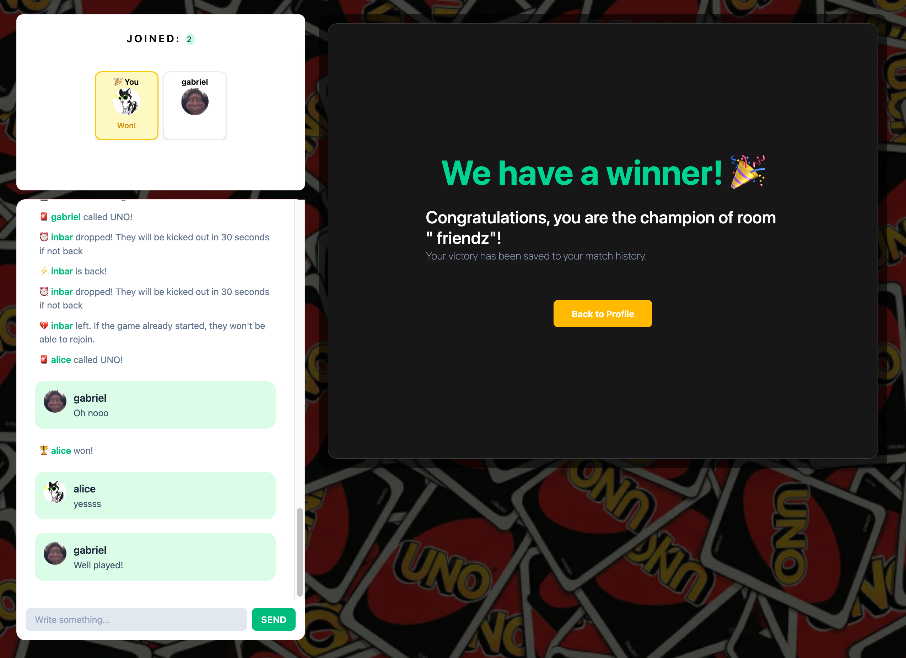</td>
    <td align="center" valign="middle">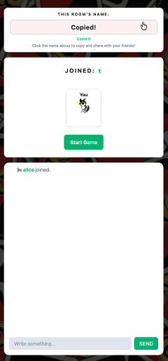</td>
    <td align="center" valign="middle">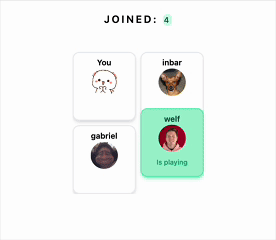</td>
  </tr>
</table>

  <div align="right"><a href="#header-menu">↑ Return to top</a></div>

## Team Roles & Workflow

Each developer was responsible for a broad but specific area of the project:

<table>
   <tr valign="top">
      <td align="center" width="25%">
         <br>
         <strong><a href="https://github.com/jslusark">@jslusark</a></strong><br>
         <strong >Full-Stack Developer <br>& Project Manager</strong><br><br>
         <div align="left">• Coordinated team deadlines, feature planning and code reviews.<br>• Built the interactive web interface, routing, authentication flow and state management.<br>• Implemented final feature integrations, bug fixes and system optimizations to ensure proper functionality across the stack.</div>
      </td>
      <td align="center" width="25%">
         <br>
         <strong><a href="https://github.com/grial">@grial</a></strong><br>
         <strong>Game Developer</strong><br><br><br>
         <div align="left">• Designed and built the core "Uno" gameplay mechanics and engine.<br>• Developed the 2D frontend game board (drag & drop, animations) using Phaser 3.<br>• Integrated the engine with the socket layer.</div>
      </td>
      <td align="center" width="25%">
         <br>
         <strong><a href="https://github.com/ilazar">@ilazar</a></strong><br>
         <strong>Backend Developer</strong><br><br><br>
         <div align="left">• Responsible for the real-time Socket.IO multiplayer layer.<br>• Managed room lifecycles and online player tracking.<br>• Managed in-game chat, drop timers and reconnection system.</div>
      </td>
      <td align="center" width="25%">
         <br>
         <strong><a href="https://github.com/wlucke">@wlucke</a></strong><br>
         <strong>Backend Developer</strong><br><br><br>
         <div align="left">• Managed database architecture and user management.<br>• Built the JWT register/login system and user profiles (with sharp image validation).<br>• Built the leaderboards and the Prisma + PostgreSQL data layer.</div>
      </td>
   </tr>
</table>

<div align="center">
Collaboration was also a key part of this experience, a combination of agile practices and resource management was used to ensure a continuous workflow.

[Kanban board](https://github.com/orgs/42-Hitchhikers-Collective/projects/) · [Resource sharing](https://app.notion.com/p/42wolfsburgberlin/Transcendence-2e9937251cae8026ac8ee6f59b496509) · [Docs folder](docs/)

</div>

  <div align="right"><a href="#header-menu">↑ Return to top</a></div>

## Tech Stack

**Frontend**<br>
     

**Backend**<br>
    

**Database**<br>


**Infrastructure**<br>
  

  <div align="right"><a href="#header-menu">↑ Return to top</a></div>

## Running the Project

1. **Check prerequisites**

   Make sure you have the following installed on your machine:

   | Tool           | Version | Purpose                                         |
   | -------------- | ------- | ----------------------------------------------- |
   | Docker         | 24+     | Container runtime                               |
   | Docker Compose | 2+      | Multi-container orchestration                   |
   | Make           | any     | Build automation                                |
   | OpenSSL        | any     | Self-signed SSL cert generation                 |
   | Node.js        | 20+     | Only needed if running a service outside Docker |

2. **Clone the repository**

   ```bash
   git clone [https://github.com/JSlusark/Uno-with-friends.git](https://github.com/JSlusark/Uno-with-friends.git)
   cd Uno-with-friends
   ```

3. **Run the project**

   ```bash
   make  # also available as `make  setup`
   ```

   One command does everything: creates `.env` with random credentials, generates a self-signed cert, tears down and rebuilds all four containers, waits for the database and then for the API to actually answer over HTTPS and prints your URL:

   ```
   ✅  App running at https://localhost:8443
   🌐  Other devices: https://192.168.x.x:8443
   ```

4. **Access the website**

   Open `https://localhost:8443` and accept the self-signed certificate warning. Migrations and seed data are applied automatically by the API container on every boot.

   Either create and log automatically with a fresh account, or one of our seeded test users:

   | Username | Email               | Password     |
   | -------- | ------------------- | ------------ |
   | alice    | alice@example.com   | Alice12345   |
   | bob      | bob@example.com     | Bob12345     |
   | charlie  | charlie@example.com | Charlie12345 |

5. **Play with friends**
   To play with friends you have to share the same network.
   Since the project is running locally on your machine, you can play with friends by sharing the LAN URL (e.g., `https://192.168.x.x:8443`) if they are on the same local network.

   The following commands are available for development and maintenance.

   | Command              | What it does                              |
   | -------------------- | ----------------------------------------- |
   | `make down`          | Stop containers, keep the database        |
   | `make re`            | Restart, data preserved                   |
   | `make logs`          | Follow logs from all containers           |
   | `make clean`         | Full project reset (containers + volumes) |
   | `make db-seed`       | Re-seed test data manually                |
   | `make prisma-studio` | Visual DB browser at `localhost:5555`     |

Full recipe list with comments: [`Makefile`](./Makefile).

  <div align="right"><a href="#header-menu">↑ Return to top</a></div>
